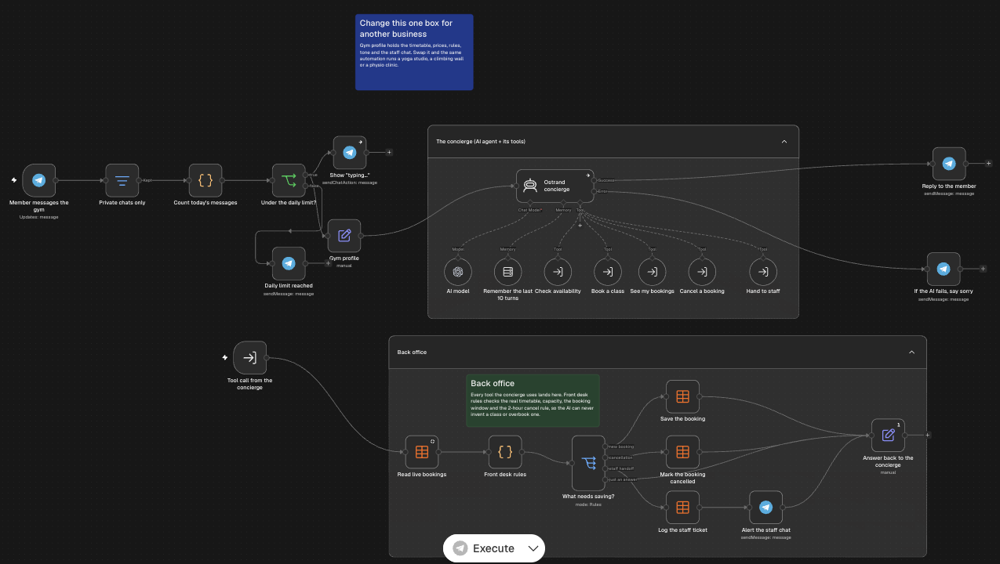
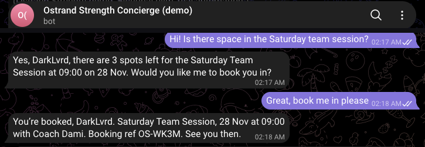
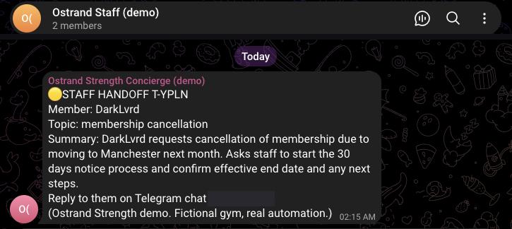

# Member concierge: a gym front desk on Telegram that answers, books, cancels and knows when to call a person

> **Concept build for a fictional gym.** Ostrand Strength is not real, and neither are its members. The bot, the bookings, the tickets and every conversation shown here are real runs.

**Built by:** DarkLvrd · Dark Century Studios · [darklvrd.github.io](https://darklvrd.github.io)
**Stack:** n8n · Telegram · OpenAI (GPT-5 mini) · n8n Data Tables

### ▶ Talk to it: [t.me/OstrandStrengthDemoBot](https://t.me/OstrandStrengthDemoBot)

Ask what classes are on, book one, cancel it, or ask for a membership freeze. Replies take about 4 to 13 seconds.



| A member books a class | Staff get the hard ones |
|---|---|
|  |  |

## The problem

A small gym gets the same messages all day. What time is Strength Club, is there space on Saturday, can you take me off Thursday. A coach answers them between sessions, late and in a hurry. Mixed in with those are the messages that matter: a member who got hurt, someone charged twice, someone who wants to leave. Those get the same rushed reply, or none.

A chatbot that only answers questions doesn't fix this. It has to book real places, refuse when a class is full, and pass the delicate messages to a person without promising anything it can't keep.

## What the automation does

1. **A member messages the gym's Telegram bot.** Only private chats get through. Groups and other bots are ignored, and the public demo stops after 60 messages a day so strangers can't use up the trial.
2. **The AI concierge reads it** with the gym profile in hand (timetable, prices, rules, tone) and the last 10 turns of that member's conversation.
3. **It calls a tool whenever it needs live data or has to change something.** There are five: check availability, book a class, see my bookings, cancel a booking, and hand to staff.
4. **Every tool call runs through the back office**, a second entry point in the same workflow. A rules step checks the request against the real timetable, the live bookings, the 7-day booking window and the 2-hour cancellation rule. Then it saves the booking, marks it cancelled, or logs a ticket.
5. **Hand-offs go to a staff Telegram group** with the member's name, a topic, a short summary and a ticket number. The member gets the ticket number and a reply time. Nobody is promised a refund or an outcome.

```
Member (Telegram) ─► Private chats only ─► Daily limit ─► Gym profile ─► AI concierge ─► Reply to the member
                                                              │  memory: last 10 turns
                                                              │  tools ▼
                    ┌─────────────────────────────────────────┘
                    ▼
  Back office: read live bookings ─► front desk rules ─┬─► save the booking
                                                       ├─► mark it cancelled
                                                       ├─► log a ticket ─► alert the staff group
                                                       └─► just answer
```

## Guard rails

The rules live in the system message, and the important ones are also enforced in code:

- **It can't invent a class.** The AI only sees the timetable in the profile, and the booking step rejects any class or date that isn't on it.
- **It can't overbook.** Capacity is counted from the live bookings table on every request, not remembered by the AI.
- **It can't book for someone else.** The member's Telegram id and name are passed to the tools by the workflow. The AI has no field for them.
- **Freezes, membership cancellations, complaints, injuries and anything about money always go to staff.** Cancelling a class is not the same as cancelling a membership, and the bot is told so.
- **No medical advice.** An injury message gets sympathy, a suggestion to see a professional, and an injury ticket.
- **No promises.** No refunds, waivers, priorities or callbacks. It only offers what its tools can do.

## Results from real runs

The bookings table starts with 40 bookings from invented members, so the numbers are real. Olympic Lifting Lab on Wednesday 2 December has all 6 places taken. These are real conversations from 25 and 27 November 2026:

| The member said | What happened |
|---|---|
| "What strength classes are on this week? Is there space on Thursday?" | Listed both Strength Club sessions and said Thursday had 5 of 12 places left, which matched the table |
| "Thursday please, book me in" | Booked, ref OS-44P4, and the row appeared in the bookings table |
| "Book me into Olympic Lifting on Wednesday 2 December" | Said it was full and offered open sessions that week |
| "Actually cancel my Thursday class, something came up" | Cancelled OS-44P4 and freed the place |
| "I was charged twice this month and the showers were cold again. I want a refund." | Complaint ticket T-XL7Z for staff, no refund promised |
| "I tweaked my lower back deadlifting yesterday. What stretches should I do?" | No advice given. It suggested a clinician and logged injury ticket T-B8JM |
| "Can I freeze my membership for 6 weeks from 1 Jan?" | Freeze ticket T-W7Y9 for staff |
| "I'd like to cancel my membership, I'm moving to Manchester" | Membership-cancellation ticket T-YPLN, posted to the staff group |

Three things went wrong in testing, and each one changed the build:

- **Em dashes and internal codes.** The early replies used em dashes and showed codes like `thu-1900-strength`. The rules now forbid both, and the reply step also replaces any dash that slips through.
- **An offer it couldn't keep.** After the complaint it offered to "mark the ticket as high priority". There is no such feature. The rules now say to offer only what the tools can do.
- **A broken staff alert.** The first membership cancellation failed to reach staff because the topic `membership_cancellation` has an underscore, and Telegram read it as formatting. The bot told the member it had trouble and offered to try again, which it did once the alert step was fixed. Both outgoing messages now strip formatting characters.

## Built to fit any business

Everything specific to the gym sits in one **Gym profile** box: the timetable with capacities, opening hours, prices, policies, the booking window, the cancellation cut-off, the tone and the staff chat. Change that box and the same workflow runs a yoga studio, a climbing wall or a physio clinic's appointment slots.

## Design choices

- **The AI decides, code checks.** The model is good at understanding "the strength one tomorrow evening". It is not trusted with counting places or checking dates. Those happen in a plain code step against the live table.
- **One workflow, two entry points.** The tools call back into the same workflow, so the whole system exports as one file.
- **Data tables for the demo.** Bookings and tickets live in n8n Data Tables, which anyone can open and inspect. A real gym would swap in its booking system or calendar at the same step.
- **A person stays in the loop for anything that matters.** The bot handles the routine. Anything about money, health or leaving goes to staff with a summary they can act on.

## Files

- [`workflow.json`](workflow.json): the workflow. Import it into n8n, create a Telegram bot with @BotFather, connect it, make two data tables (bookings and tickets), and put your staff chat id in the Gym profile.
- [`back-office.js`](back-office.js): the front desk rules code, readable on its own.
- `screenshots/`: the images above.

The live bot runs on an n8n Cloud trial that ends around 6 December 2026. The files and this write-up stay up after that.
