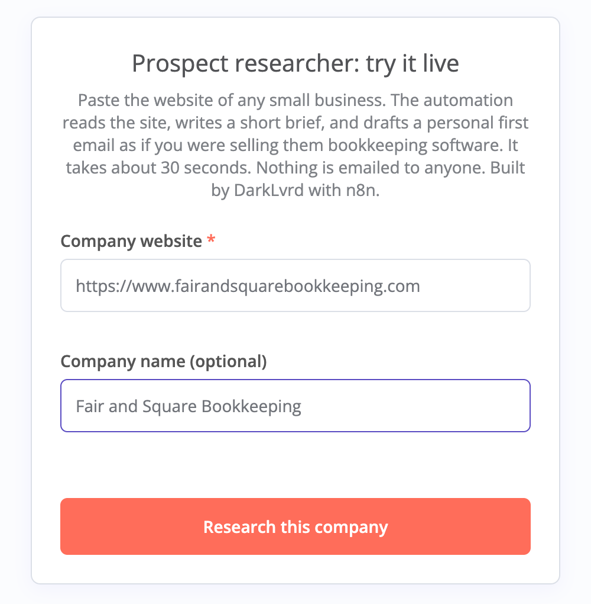
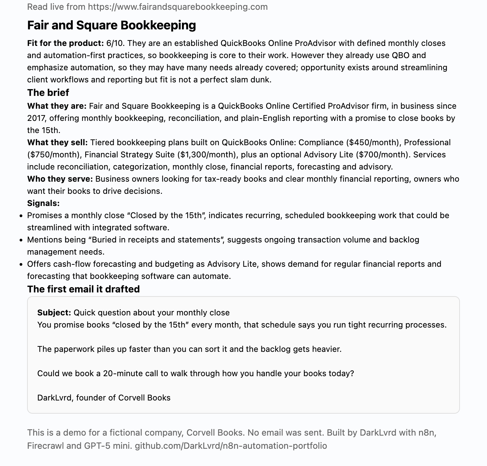

# Prospect researcher: a personal first email for every prospect, written from their own website

> **Concept build for a fictional company.** Corvell Books is not real. The prospect websites are real and public. The automation only reads them and never contacts them.

**Built by:** DarkLvrd · Dark Century Studios · [darklvrd.github.io](https://darklvrd.github.io)
**Stack:** n8n · Firecrawl · OpenAI (GPT-5 mini) · Gmail · Telegram

### ▶ [Try it live](https://darklvrd.app.n8n.cloud/form/corvell-try) · [Watch the 19-second demo](demo.mp4) · [Vertical cut](demo-vertical.mp4)

Paste the website of any small business. About 30 seconds later you get a brief on that company and a first email written for it. Nothing is sent to anyone.


| You paste a website | You get a brief and a first email |
|---|---|
|  |  |

## The problem

A founder selling bookkeeping software has a list of small bookkeeping practices to contact. A good first email shows you read their site. That takes 15 to 20 minutes per company, so most people skip it and send one template to everyone. Template emails get deleted.

## What the automation does

For every company on the list, without anyone touching it:

1. **Reads the website.** Firecrawl turns the home page into clean text.
2. **Finds a second page.** It looks through the links for an about, services or pricing page and reads that too.
3. **Writes a brief.** One AI call fills fixed fields: what the company is, what it sells, who it serves, two or three signs it needs the product, a fit score from 1 to 10 with the reason, and one hook taken from their own site.
4. **Writes the first email.** Under 110 words. It opens with the hook, names one problem in their language, and makes one clear ask.
5. **Saves it as a Gmail draft and sends a Telegram ping** with the score and the hook. A person reads the draft before anything goes out.

```
Prospect list ─► Read home page ─► Find about/services page ─► Read it ─► Combine text
                                                                              │
                                    AI: brief + fit score + first email ◄─────┘
                                              │
                               ┌──────────────┴──────────────┐
                               ▼                             ▼
                        Gmail draft                  Telegram ping
```

## Results from real runs

The first run on 24 November 2026 read five real bookkeeping practices in the UK and the US in 73 seconds. The briefs were good. The emails were not. They opened by copying the prospect's own sentence back at them, for example "We are a small, family-run business based in Wimborne...", and two of them cut the 20-minute call down to 15.

I rewrote the rules. The hook now has to be an observation in the sender's voice, quoting a short phrase at most. The call length is fixed, and so is the sign-off. The second run took 82 seconds:

| Prospect | Fit | How the email opened |
|---|---|---|
| A Touch Bookkeeping (Witham, UK) | 9/10 | "You describe helping businesses that have 'outgrown the shoebox of receipts,' which often means manual monthly catch-up work." |
| MVP Bookkeeping (Penzance, UK) | 8/10 | "You advertise 'E-commerce bookkeeping, VAT and accounting', which often means many sales channels and lots of reconciliations." |
| Fair and Square Bookkeeping (US) | 8/10 | "You promise books 'closed by the 15th' every month, which shows you run a disciplined monthly close process." |
| Ledger Leaf Ltd (Knaresborough, UK) | 7/10 | "Your site invites clients to 'Spend less time on paperwork,' which points to bookkeeping taking valuable time for you or your clients." |
| LVS Bookkeeping (Wimborne, UK) | 6/10 | "You describe LVS Bookkeeping as a 'small, family-run' practice in Wimborne serving sole traders and small businesses." |

The scores are spread out. The AI ranked a small family practice lower than a firm that does monthly reconciliations for many clients, and it gave a reason each time.

Two of the five emails still said 15 minutes. That's why the last step saves a draft instead of sending.

## The demo video

The [19-second cut](demo.mp4) follows one round end to end: the website read, the brief, the email, then the real run at 97 seconds for five sites with the five Gmail drafts. Everything on screen is from real runs. The [vertical version](demo-vertical.mp4) is a native 9:16 layout for Reels and Shorts.

Music: "Man mountain (Electro House)" by AlexZavesa (Jamendo), CC BY.

## The public demo

The [try-it page](https://darklvrd.app.n8n.cloud/form/corvell-try) is a second, smaller workflow ([`try-it-workflow.json`](try-it-workflow.json)). It reads one page and shows the result on screen. Things I added because strangers can use it:

- **A daily cap of 40 runs**, so nobody can burn through the AI and scraping credits.
- **A link check.** Anything that isn't a website link gets a polite "try again" page.
- **A bot filter**, so link previews and crawlers can't trigger it.
- **A rule that website text is data**, so a page that hides instructions for the AI gets ignored.
- **An "unreadable site" page** for blank, blocked or tiny sites.
- **A Telegram ping** to me whenever someone tries it.

## Built to fit any business

What the product is, who it's for, the pains it solves, the offer and the tone all sit in one **profile** box. The prospect list is another box with one line per company. To sell gym software to gyms, change those two boxes and nothing else.

## Design choices

- **Drafts, not sends.** Cold email needs a human check. The automation does the 15 minutes of reading and writing. A person spends 30 seconds approving.
- **Fixed output fields.** The AI must answer in the same shape every time, so the email step and the Telegram step can trust it.
- **"Not stated" is allowed.** The brief must say "not stated" when the site is silent, which stops the AI inventing team sizes or client counts.
- **Two pages per company.** Home pages are often slogans. The about or services page is where the real detail is.

## Files

- [`workflow.json`](workflow.json): the main workflow. Import it into n8n, connect your own Gmail and Telegram, and fill in the profile and the list.
- [`try-it-workflow.json`](try-it-workflow.json): the public demo.
- `screenshots/`: the images above.

The live demo runs on an n8n Cloud trial that ends around 6 December 2026. The files and this write-up stay up after that.
