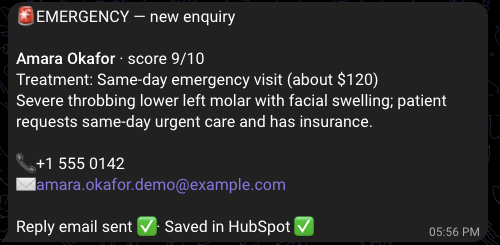
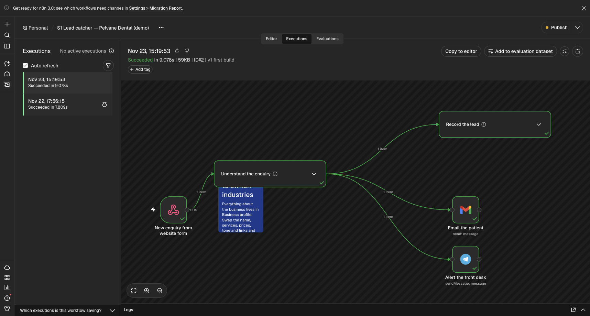
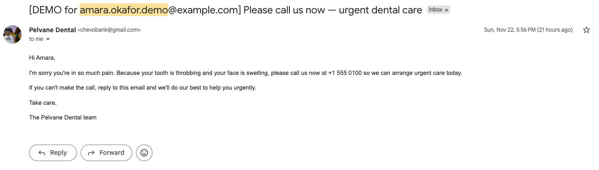
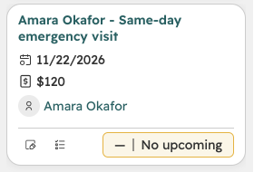
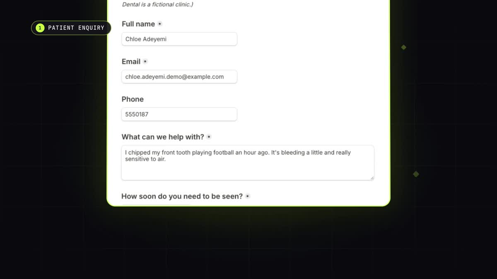

# Lead catcher: every enquiry answered in under 10 seconds

> **Concept build for a fictional client.** Pelvane Dental is not a real clinic. The automation, the tools and the runs shown here are real.

**Built by:** DarkLvrd · Dark Century Studios · [darklvrd.github.io](https://darklvrd.github.io)
**Stack:** n8n · Tally · OpenAI (GPT-5 mini) · HubSpot CRM · Gmail · Telegram · Cal.com

### ▶ [Watch the 19-second demo](demo.mp4) · [vertical 9:16 cut](demo-vertical.mp4)

A real run, start to finish, in 19 seconds: form → AI → Telegram alert → reply email → HubSpot deal. The automation itself took **8.9 seconds**.

**Voiceover:** "Missed enquiries? Lost patients. A patient fills in your form. In nine seconds, AI reads it, alerts your front desk, replies in your clinic's voice, and logs the deal in your CRM. Every lead. Caught. For any business."

Shot by shot: a pile-up of unanswered enquiries freezes → logo hit → headline → the real form flying in → the n8n run with a counter → the front-desk alert slamming in → the reply email → the deal in the CRM → industry chips → logo and link. Sound on every cut.

*Music: "House Music" by DJ Frankie Holmes (Jamendo, track 1287214), CC BY. Voice: ElevenLabs. Built with the Dark Century Studios motion system (`~/dcs-motion/videos/s1-lead-catcher-promo`); the CapCut projects are **S1 Lead Catcher - 16x9** and **S1 Lead Catcher - 9x16**. Video is a real captured run, not a mock-up.*



## The problem

A dental clinic's website enquiries land in a shared inbox and wait. Someone with a swollen face waits as long as someone asking about whitening, and the slow reply sends patients to the clinic down the road. Nobody records the lead, so nobody follows it up.

## What the automation does

When a patient sends the "Book a visit" form, without anyone touching it:

1. **Catches it instantly.** The form calls n8n through a webhook.
2. **Loads the business profile.** Clinic name, hours, price list, tone of voice and booking link all live in one box.
3. **Lets AI read it like a receptionist would.** It decides:
   - urgency: emergency, soon or routine
   - most likely treatment and its value, from the clinic's price list
   - lead score from 1 to 10, with its reasoning
   - a personal reply email in the clinic's tone
4. **Then does three things at once:**
   - **HubSpot:** creates or updates the patient as a contact and opens a deal with the score, value and AI reasoning attached.
   - **Email:** sends the personal reply. Emergencies are told to call now. Everyone else gets the booking link.
   - **Telegram:** alerts the front desk, with 🚨 at the top for emergencies.

```
Form ─► n8n ─► Business profile ─► Read answers ─► AI: rate + draft reply ─┬─► HubSpot contact ─► HubSpot deal
                                                                          ├─► Email reply (+ booking link)
                                                                          └─► Telegram front-desk alert
```



## Results from real runs

| Test enquiry | AI urgency | Score | What happened | Time |
|---|---|---|---|---|
| "My molar has been throbbing since last night and my face is starting to swell" | 🚨 emergency | 9/10 | "Call us now" email (no booking link), $120 emergency deal in HubSpot, 🚨 Telegram alert | ~8 s |
| "I chipped my front tooth playing football an hour ago. It's bleeding a little" | 🚨 emergency | 10/10 | "Call us now" email, $120 deal, 🚨 alert (the run in the demo video) | 8.9 s |
| "I have a running nose" (off-topic, marked *today, urgent*) | 🟢 routine | 5/10 | AI saw it isn't dental, said so politely, still offered a check-up booking link and explained when to call | ~9 s |

The second test was a deliberate curveball. The form said "urgent", but the AI didn't panic. It read the actual words and handled it the way a sensible receptionist would.

| Reply email | HubSpot deal |
|---|---|
|  |  |



## Built to fit any business

Everything specific to the clinic sits in one **Business profile** box: name, services, prices, tone, links. Change that box and the same workflow catches leads for a gym, a salon, a law firm or a real-estate agency.

A **demo mode** switch sends every email to the builder's own inbox instead of the person who filled in the form. That makes it safe to show live.

## Design choices

- **One AI call, structured output.** The AI must answer in a fixed format (urgency, treatment, score, value, summary, reasoning, email). Every later step can rely on those fields, and it keeps the cost to one model call per lead.
- **Reasoning is stored in the CRM.** Staff can see *why* a lead scored 9, not just that it did.
- **Rules the AI must follow:** never diagnose, never quote outside the price list, never send an emergency to a booking page.
- **Parallel actions.** The CRM, email and alert don't wait on each other.

## Files

- `workflow.json`: the n8n workflow. Import it into n8n, then connect your own HubSpot, Gmail and Telegram accounts and fill in the Business profile.
- `make_form.py`: builds the Tally form through Tally's API.
- `demo.mp4` / `demo-vertical.mp4`: the 19 s edit, 1080p60, 16:9 and 9:16.
- `screenshots/`: the images above.
